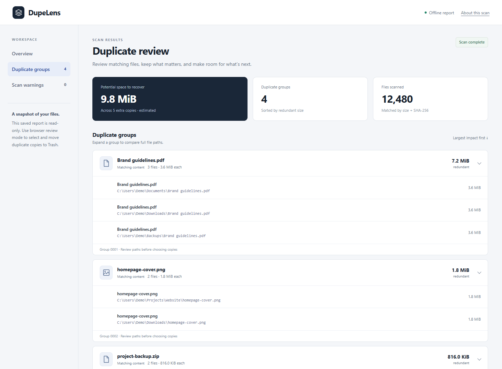

<div align="center">

# DupeLens

**Find the copies. Keep what matters.**

A read-only duplicate finder and local browser workspace, built with Java.
Zero runtime dependencies. No telemetry. Your files stay on your machine.

[](https://github.com/illusionoftalha/dupelens/actions/workflows/ci.yml)
[](https://github.com/illusionoftalha/dupelens/releases/latest)

[](LICENSE)

[Download](https://github.com/illusionoftalha/dupelens/releases/latest) · [Contribute](.github/CONTRIBUTING.md) · [Support](.github/SUPPORT.md) · [Security](.github/SECURITY.md) · [Code of Conduct](.github/CODE_OF_CONDUCT.md)

</div>

---



*An offline report with scan totals, duplicate groups, and full file paths.*

## Choose your workflow

| App | What it does | File operations |
| --- | --- | --- |
| CLI | Scan a folder, print matches, export a portable HTML report. | Read-only; report creation never overwrites an existing file. |
| Browser review | Search groups, choose keepers, select extra copies, review a confirmation, and move copies to system Trash. | Only after explicit confirmation; no permanent-delete fallback. |

Both require **Java 17 or newer**. Building from source also requires a JDK and Maven.

## Download and run

Download a JAR from [GitHub Releases](https://github.com/illusionoftalha/dupelens/releases/latest). The current stable assets are:

- **`dupelens-1.2.1.jar`** — read-only CLI and saved reports.
- **`dupelens-review-1.2.1.jar`** — browser review and confirmed Trash actions.
- **`SHA256SUMS.txt`** — SHA-256 checksums for both JARs.

The source-code ZIP is not a runnable application. Run from the folder containing the JAR and quote paths with spaces.

### Read-only scan and report

```sh
java -jar dupelens-1.2.1.jar "/path/to/folder" --html report.html
```

Open `report.html` in a browser. The self-contained report has no JavaScript, server, remote assets, or delete controls. Choose a new filename if the report already exists.

### Browser review and deletion

From PowerShell on Windows:

```powershell
java -jar .\dupelens-review-1.2.1.jar "C:\Users\YourName\Downloads"
```

On Linux or macOS:

```sh
java -jar dupelens-review-1.2.1.jar "/path/to/folder"
```

After scanning, the app opens a private local URL or prints it for you to open. **Keep the terminal running** while using the browser; Ctrl+C ends the session. Browser review uses JavaScript and connects only to the Java process on `127.0.0.1`.

1. Expand a group and compare full paths. Use **Keep** to protect your preferred copy.
2. Check unwanted copies, choose **Select other copies** within a group, or choose **Select all extra copies** across every group, including groups hidden by search. Nothing is selected initially.
3. Click **Delete selected**, review selected paths and retained copies, then confirm **Move to Trash**. Cancel leaves files untouched.
4. Review the result and download the CSV action log before ending the session. The log is held in memory.

Large selections use sequential requests of up to 500 IDs after one confirmation. Request errors stop further requests; reload and inspect the action log before retrying. A saved `file://` report cannot delete arbitrary local paths; launch the review JAR for that workflow.

If a Windows JDK reports `Unable to establish loopback connection`, try a writable socket directory. The current directory must exist and be writable:

```powershell
java "-Djdk.net.unixdomain.tmpdir=$PWD" -jar .\dupelens-review-1.2.1.jar "C:\Users\YourName\Downloads"
```

### Verify a download

Compare the JAR's SHA-256 hash with the corresponding line in the release's `SHA256SUMS.txt`. In PowerShell:

```powershell
Get-FileHash .\dupelens-review-1.2.1.jar -Algorithm SHA256
```

## Skip folders when scanning

Available in source builds of the next version; the published 1.2.1 JARs do not support this option yet. Build with `mvn package`, then repeat `--exclude` for each folder to skip:

```sh
java -jar target/dupelens.jar "/path/to/folder" --exclude .git --exclude node_modules --html report.html
java -jar target/dupelens-review.jar "/path/to/folder" --exclude "old backups" --exclude projects/cache
```

A single folder name matches at any depth. A multi-component path matches from the scan root; both slash styles are accepted. Matching follows the platform's path case rules. Excluded subtrees do not appear in counts, reports, or review selections. No folders are excluded by default, and the explicitly selected scan root is always scanned. Exclusions apply to folders, not individual files; wildcards, absolute paths, and `.` or `..` segments are rejected.

## How it works

Files are grouped by size, then candidates are hashed with SHA-256 in 64 KiB chunks. Matching fingerprints form groups sorted by redundant logical bytes. Symbolic links are skipped, ordinary read failures become warnings, and hard-link aliases are excluded where file identity is available.

In browser review, the backend accepts only IDs from the current session, checks that a copy remains, validates file/keeper metadata and resolved paths, compares bytes, then rechecks metadata immediately before each native Trash call. Changed or mismatched files are skipped and reported. Trash support varies by OS/JDK/desktop session; when unsupported, deletion is disabled.

### Limits and privacy

- Scans are snapshots, not live filesystem views. Hash matches in the CLI are not byte-verified; review verifies bytes before moving files.
- Verification and native Trash are separate operations. External writers can still race the final move; close programs changing the files and rescan after changes.
- Space estimates measure redundant logical bytes. Compression, deduplication, snapshots, filesystem allocation, and Trash retention affect actual free space.
- File metadata grows with file count, although stream buffers are bounded. Empty files may form zero-space groups.
- Reports and logs contain full local paths. Review before sharing; keep live review URLs private.
- Image similarity, wildcard exclusion patterns, scan cancellation, and persistent logs are not implemented.

Read the [architecture](docs/architecture.md) for implementation details and [security policy](.github/SECURITY.md) for reporting and boundaries.

## Build and test

```sh
sh scripts/test.sh
mvn --batch-mode package
python scripts/check_repository.py
python scripts/check_artifacts.py
```

Both `mvn test` and `mvn package` run `SmokeTest.main()` and `ReviewTest.main()` in separate JVMs through the build-only Exec plugin. Assertion failures and nonzero exits fail the build. Surefire is disabled because these suites use main methods, not a test framework. The standalone test scripts still work without Maven. `-DskipTests` deliberately skips both suites and is not validation evidence. Python 3.10+ is used only for repository and packaging checks.

Maven creates `target/dupelens.jar` and `target/dupelens-review.jar`. Direct CLI source execution remains supported:

```sh
java src/main/java/dev/dupelens/Main.java ./your-folder
```

CI runs the Java 17/21 matrix on Linux, macOS, and Windows, checks documentation, and verifies that the CLI JAR excludes review/deletion classes. Automated review tests use temporary fixtures and fake Trash; they never move user files to native Trash.

## Find your way around

| Location | Contents |
| --- | --- |
| [`src/`](src/) | Java application code and integration checks. |
| [`scripts/`](scripts/) | Test runners, repository checks, and release utilities. |
| [`docs/`](docs/README.md) | Architecture, maintainer guidance, and screenshots. |
| [`.github/`](.github/) | CI, issue templates, contribution and community policies. |
| [`pom.xml`](pom.xml) | Maven packaging for the CLI and browser review JARs. |
| [`CHANGELOG.md`](CHANGELOG.md) | Release history and upcoming changes. |

## Community

See [CONTRIBUTING.md](.github/CONTRIBUTING.md) for setup and review expectations, [open issues](https://github.com/illusionoftalha/dupelens/issues) for contribution opportunities, and [CHANGELOG.md](CHANGELOG.md) for released and unreleased changes. Everyone participating follows the [Code of Conduct](.github/CODE_OF_CONDUCT.md).

Maintainer procedures are in [docs/maintaining.md](docs/maintaining.md). Support is volunteer-run; response times and release dates are not guaranteed.

## License

[MIT](LICENSE), copyright DupeLens contributors.
